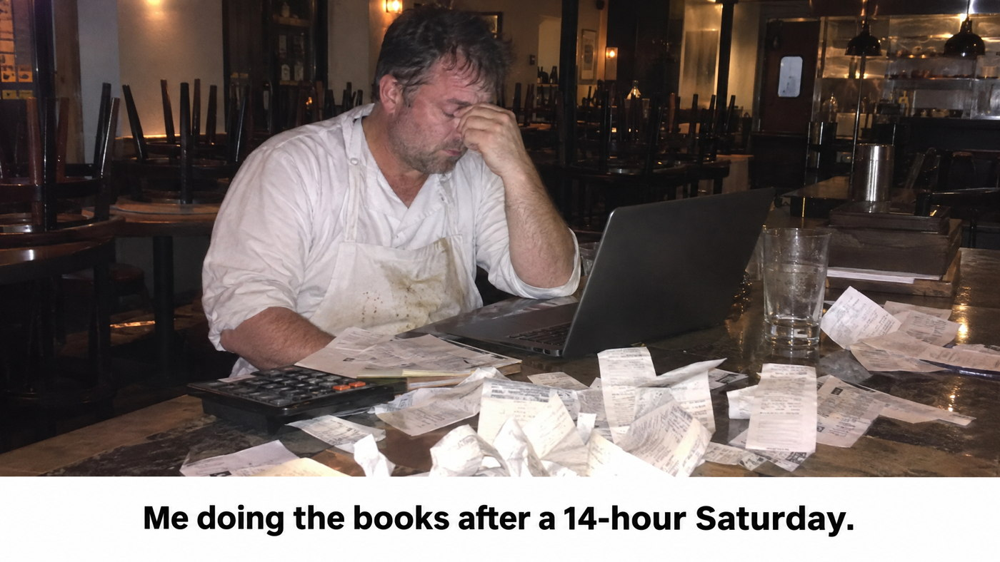

# Meme Outreach

Turn quiet prospects into conversations with personalized memes, in Claude Code.

You give it a prospect thread (or a list of 100 prospects) and say whose prospects they are. It makes:

- **A meme** about a pain the prospect will recognize: a brand-new, real-looking photo scene of people or animals, written from your client's insight map.
- **A two-line DM** to send with it: one line tying the meme to them, one casual question. No pitch.

It works in two parts:

1. **Client setup** (once per client): builds the client's brief and a 20-row pain-to-meme map, and saves them as a client skill.
2. **Make memes** (every time): reads that client skill and turns threads or lists into memes plus DMs.

## Install (one step)

```bash
claude plugin marketplace add prity-creator/meme-outreach && claude plugin install meme-outreach@meme-outreach
```

Or inside Claude Code: `/plugin marketplace add prity-creator/meme-outreach`, then `/plugin install meme-outreach@meme-outreach`. Restart Claude Code (or run `/reload-plugins`) afterwards.

Captions are added by a small Python script, so you also need Pillow: `pip install pillow`.

## Part 1: set up a client

```
/meme-outreach:client-setup Acme
```

or just say "set up Acme for meme outreach". It first asks where the client information is:

1. **A folder** (docs, notes, briefs, call transcripts)
2. **.md or text files**
3. **A skill or plugin you already have** (for example a DM-reply skill with a client brief)
4. **Nowhere yet** (it asks you questions, and can read the website)

Then it builds the brief (what the client does, services, who it caters to, locations, what a qualified lead is, outreach and voice, why people buy, pain points, real proof points, objections, next step, off-limits), asks only about what's missing, and builds the pain-to-meme map:

> pain → consequence → situation → why it's funny → meme → caption → casual question

It saves the result as a client skill in `~/.claude/skills/<client>-memes/` and as a `.zip` you can share with your team. See a complete made-up example in [`examples/northwind-memes/`](examples/northwind-memes/).

## Part 2: make memes

**One prospect**

```
/meme-outreach:make-memes This is an Acme prospect, they went quiet after my second message.
<paste the thread>
```

**A list**

```
/meme-outreach:make-memes Make memes for this list of Acme prospects. It's a follow-up.
<attach prospects.csv>
```

You can also just ask in plain words; Claude picks the skill on its own. Batch runs group prospects by pain, show you the plan before making any images, and save `meme-outreach-output/<client>-<date>/` with the memes and `messages.csv` (each prospect's meme file and two messages), ready for any sending tool. Input columns: [`prospects_template.csv`](plugins/meme-outreach/skills/make-memes/templates/prospects_template.csv).

## Example

A made-up restaurant owner (a prospect of the made-up Northwind Bookkeeping) who went quiet after two messages. The image was made with Tella:



> Third location's been open a month now, so this one felt honestly a little too real 😅
>
> [new message]
>
> Who ends up doing the books across all three, still you?

Full walkthrough: [examples/tella-example.md](examples/tella-example.md)

## Where the images come from

Claude writes every meme as a fresh image prompt, built from the client's pain-to-meme map and the prospect's own words. An image generator renders it, using the first one that works:

1. **Tella** (if the Tella connector is available in Claude Code)
2. **Gamma** (if the Gamma connector is available)
3. **Any other image generator** you've connected

Claude itself can't render photos. If no generator is available or credits run out, you still get the DM plus the finished prompt, ready to paste into any image tool (ChatGPT, Gemini, Ideogram, Midjourney).

## Ground rules baked in

- Every meme is an original, real-looking photo of people or animals. No cartoons, drawings, famous meme templates, celebrities or logos.
- Jokes are about the situation, never about the prospect.
- No meme for people who said no, are mid-conversation, or already got one.
- Every DM is checked by a script: two short messages, no pitch, no links, no jargon.
- Never invents client facts, results or quotes. Your client briefs stay on your machine; nothing about your clients is in this repo.

## License

MIT
